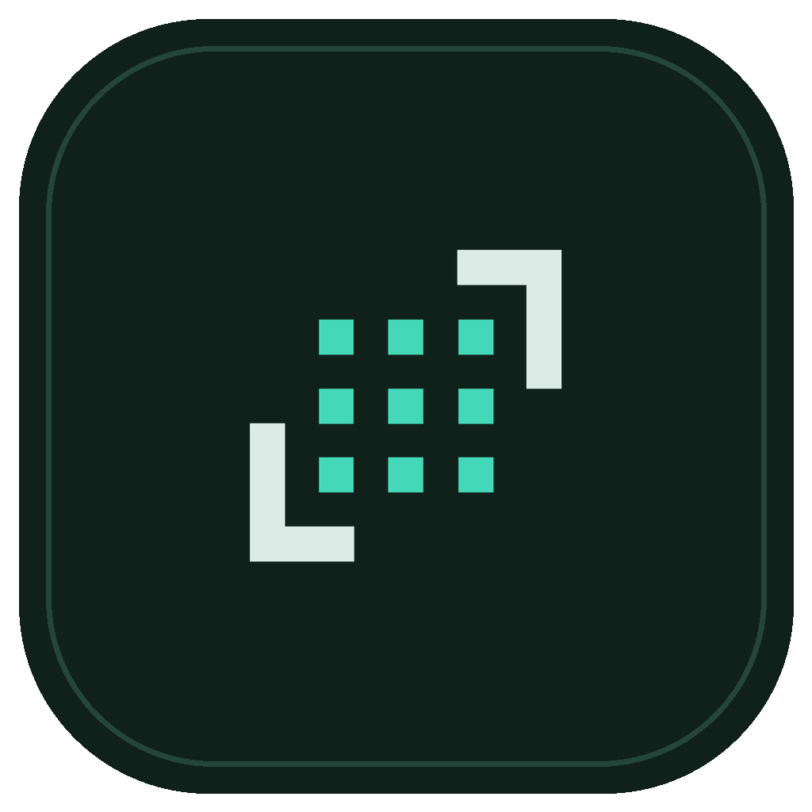
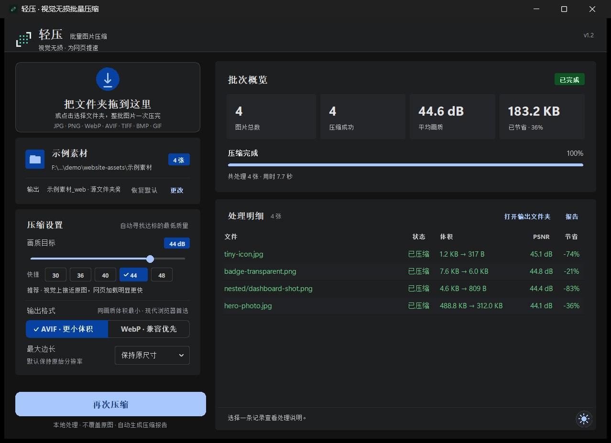

# 轻压 · 批量网页图片压缩

<p align="center">
  
</p>

<p align="center">
  <a href="https://github.com/yunshangnanchen/lightpress/actions/workflows/build.yml"></a>
  
  
  <a href="https://github.com/yunshangnanchen/lightpress/releases"></a>
  
</p>

轻压（LightPress）是一个批量网页图片压缩工具：**把一个文件夹拖进窗口，整批输出 AVIF / WebP**。

它不会给所有图片套一个质量值，而是对每张图单独搜索「刚好达到画质目标」的最低编码质量，在 30–48 dB 之间尽量压小体积，同时保留透明通道和目录结构。

- 默认 **44 dB + AVIF**：优先保证网页上的视觉清晰度。
- 提供 **30 dB 极限压缩档**：用于缩略图、背景图和非重点配图。
- 原图不会被修改，结果写入旁边的 `_web` 文件夹。
- 纯本地离线运行，**不需要账号、API Key，也不会联网或上传图片**。



*浅色模式：[docs/preview-light.png](docs/preview-light.png)*

---

## 目录

- [核心特性](#核心特性)
- [画质档位](#画质档位)
- [安装与运行](#安装与运行)
- [使用说明](#使用说明)
- [输出规则](#输出规则)
- [工作原理](#工作原理)
- [命令行](#命令行)
- [项目结构](#项目结构)
- [构建安装包](#构建安装包)
- [开发与测试](#开发与测试)
- [安全与隐私](#安全与隐私)
- [常见问题](#常见问题)
- [许可证](#许可证)

## 核心特性

- **文件夹直接拖入**：递归处理所有子文件夹，保留相对目录结构。
- **逐张自适应压缩**：对每张图二分搜索最低编码质量，而不是全局套用一个质量值。
- **画质双门槛**：以 PSNR 为目标，SSIM 作为辅助保护；透明图额外检查 alpha 边缘。
- **色彩统一到 sRGB**：Display P3、Adobe RGB 等广色域图片先做色彩管理转换再编码，避免不同浏览器忽略 ICC 造成偏色。
- **30–48 dB 可调**：界面滑杆 + `30 / 36 / 40 / 44 / 48` 快捷档位。
- **AVIF / WebP 可选**：默认 AVIF，同画质通常更小；WebP 兼容范围更广。
- **Material 3 界面**：圆角表面、色调分层与状态层；深色 / 浅色通过右下角圆形按钮切换，并带圆形遮罩过渡动画。
- **安全输出**：不覆盖源文件，输出目录可自定义。
- **自动报告**：每批输出 `压缩报告.csv`，包含体积、PSNR、SSIM、质量值和说明。
- **稳健批处理**：单张失败不影响整批，动图原样复制，可随时取消。

## 画质档位

| 目标 | 适用场景 | 体积趋势 |
| --- | --- | --- |
| 30–34 dB | 极限压缩：缩略图、背景、预加载占位 | 极小；细节明显减少 |
| 35–39 dB | 高压缩：非重点配图、画廊缩略图 | 更小 |
| 40–42 dB | 轻量：背景图、内容配图 | 小 |
| 43–44 dB | 日常网页配图（默认 44） | 均衡 |
| 45–46 dB | 首屏大图、商品图 | 偏大 |
| 47–48 dB | 接近像素级保留的重点图 | 最大 |

工具追求的是：**在不低于目标值的前提下，找到体积最小的编码质量**。最终 PSNR 通常在目标附近，简单图形可能高于 48 dB。

> 30–39 dB 属于明显有损压缩，可能出现色块、文字发虚和细节丢失，不适合重要商品图或带文字的界面截图。
>
> 默认 44 dB 是「工程意义上的视觉高保真」，不是数学无损。真正逐像素无损请保留原始 PNG，或使用专门的 WebP lossless 工作流。

## 安装与运行

### Windows 安装包（推荐）

1. 打开 [Releases](https://github.com/yunshangnanchen/lightpress/releases)，下载 `LightPress-x.y.z-Setup.exe`。
2. 双击安装。默认按**当前用户**安装到 `%LocalAppData%\Programs\LightPress`，**不需要管理员权限**。
3. 从开始菜单或桌面快捷方式启动；卸载在「设置 → 应用」里进行。

系统要求：Windows 10 / 11（64 位）。

> 安装包没有代码签名，首次运行 Windows SmartScreen 可能提示「未知发布者」，选择「更多信息 → 仍要运行」即可；不放心可以从源码自行构建。

### Windows 免安装版

在 [Actions](https://github.com/yunshangnanchen/lightpress/actions/workflows/build.yml) 的构建产物（或 Release）里下载 `LightPress-x.y.z-windows-portable.zip`，解压后直接运行 `LightPress.exe`。

### Linux

下载 `LightPress-x.y.z-linux-x86_64.tar.gz`，解压后运行：

```bash
tar -xzf LightPress-*.tar.gz
cd LightPress
./launch.sh
```

- 需要系统自带 Tk 运行库；精简系统请先安装（Debian/Ubuntu：`sudo apt install python3-tk`）。
- 包在 Ubuntu 22.04 上构建，要求 glibc ≥ 2.35（Ubuntu 22.04+、Debian 12+ 等）。
- **Linux 版没有拖拽**（拖拽组件只有 Windows 预编译库），请点击虚线区域选择文件夹。

### 从源码运行

需要 **Python 3.10+**（推荐 3.11 / 3.12）。

```powershell
python -m pip install -r requirements.txt
python app.py
```

Windows 上也可以直接双击：

1. `安装依赖.bat`：Pillow 和 NumPy 会装进项目内的 `.deps`，不影响其它 Python 环境。
2. `启动工具.bat`：启动界面。
3. 启动失败时双击 `调试启动.bat`，命令行窗口会保留错误信息。

拖拽组件已随仓库附带（`vendor/tkinterdnd2`），不需要额外安装。命令行版本见 [命令行](#命令行)。

## 使用说明

1. 拖入文件夹（不是单个文件），工具会递归扫描子目录并统计数量与体积。
2. 选择画质目标和输出格式：
   - **AVIF**：默认，同画质体积通常最小，现代浏览器推荐。
   - **WebP**：兼容范围更广；高纹理照片在 44 dB 附近可能达到编码器上限，此时会保留原图。
3. 需要限制网页展示尺寸时，可选「最大边长」；默认保持原始分辨率。
4. 点击「开始压缩」，完成后可直接打开输出文件夹或 CSV 报告。
5. 右下角圆形按钮可在深色 / 浅色之间切换，选择会记住。

支持格式：

```text
JPG / JPEG / PNG / WebP / AVIF / TIFF / TIF / BMP / GIF
```

动图 GIF / WebP / AVIF 原样复制，避免丢帧；不支持 SVG、HEIC/HEIF。

## 输出规则

以源文件夹 `D:\相册` 为例：

```text
D:\相册\                       ← 原图，始终不改动
D:\相册_web\                   ← 输出目录
├─ photo.avif
├─ screenshot.avif
├─ nested\
│  └─ art.avif
├─ already-small.jpg           ← 收益不足 2% 时保留原图
└─ 压缩报告.csv
```

- 保留子目录结构；同名不同后缀会自动生成不冲突的文件名。
- 输出收益不足 **2%** 时保留原图，避免额外有损转码。
- 达不到画质门槛时保留原图，并在报告中说明。
- 如果输出目录已存在，工具会询问是否继续，只覆盖同名输出，不碰源文件。
- 网站引用后缀会变化（如 `.jpg` → `.avif`），上线时需要同步更新图片路径；建议用 `<picture>` 给 AVIF 配置 WebP / JPEG 回退。

## 工作原理

1. 递归扫描图片，应用 EXIF 方向信息。
2. 将广色域图片通过 LittleCMS（Pillow ImageCms）统一转换到 sRGB。
3. 在编码质量范围内二分搜索：
   - 每次编码后立即解码，并按白底合成透明区域计算；
   - 检查整图 PSNR、缩小到 ≤1280 px 的灰度 SSIM；
   - 透明图额外要求 alpha 通道 PSNR ≥ 48 dB；
   - 40 dB 以上使用严格的 SSIM ≥ 0.985；30–39 dB 按目标自动放宽 SSIM 下限，避免局部崩坏。
4. 保留能达标的最低质量，写入输出目录并生成 CSV。

AVIF 使用 Pillow 的编码器，4:4:4 色度采样；WebP 使用 method 6。

## 命令行

```powershell
# 默认 44 dB、AVIF，输出到 相册_web
python compress.py "D:\相册"

# 极限压缩，适合缩略图 / 背景
python compress.py "D:\缩略图" --target 30

# WebP + 较高压缩
python compress.py "D:\相册" --target 42 --format webp

# 指定输出目录，并限制最长边
python compress.py "D:\相册" -o "D:\网站\assets" --max-dimension 2560

# 多个文件夹会分别输出到各自的 _web
python compress.py "D:\文章图" "D:\商品图" --target 44
```

参数：

```text
inputs                 一个或多个图片文件夹
-o, --output           输出目录（仅单输入时可用）
--target               目标 PSNR，30–48，默认 44；30–39 为明显有损
--format               avif 或 webp，默认 avif
--max-dimension        最大边长，默认 0（不缩放）
--workers              并行数，默认 4
-v, --verbose          逐张输出结果
```

退出码：`0` 全部成功；`1` 有失败图片；`130` 手动取消。

## 项目结构

```text
lightpress/
├─ 启动工具.bat
├─ 安装依赖.bat
├─ 调试启动.bat
├─ app.py                 # 程序入口
├─ app_window.py          # 窗口、界面布局与压缩流程
├─ material.py            # Material 3 自绘组件
├─ theme.py               # M3 配色、系统主题、标题栏
├─ screenshot.py          # 窗口截图（主题切换遮罩用）
├─ compress.py            # 命令行入口
├─ LightPress.spec        # PyInstaller 打包配置（onedir）
├─ installer/
│  └─ lightpress.iss      # Inno Setup 安装包脚本
├─ packaging/linux/       # Linux 启动脚本与安装说明
├─ .github/workflows/
│  └─ build.yml           # CI：测试 + Windows 安装包 + Linux tar.gz + Release
├─ compressor/
│  ├─ core.py             # 扫描、色彩管理、PSNR/SSIM、编码、报告
│  └─ __init__.py
├─ vendor/
│  └─ tkinterdnd2/        # 拖拽组件及第三方许可证
├─ assets/                # Logo、深浅色标记、应用图标
├─ docs/                  # README 截图
├─ tests/
│  └─ test_core.py
├─ requirements.txt
├─ LICENSE
├─ THIRD_PARTY_NOTICES.md
├─ .gitignore
└─ .gitattributes
```

`settings.json`、日志、`.deps`、`dist/`、测试输出和 `_web` 结果都是本地生成的，已加入 `.gitignore`。

## 构建安装包

需要 **Python 3.10+** 和 **Inno Setup 6.3+**（Windows）。

```powershell
python -m pip install -r requirements.txt pyinstaller

# 1) 生成 onedir 目录：dist\LightPress\LightPress.exe
python -m PyInstaller --noconfirm --clean LightPress.spec

# 2) 生成安装包：dist\installer\LightPress-1.2-Setup.exe
& "C:\Program Files (x86)\Inno Setup 6\ISCC.exe" installer\lightpress.iss

# 也可以指定版本号
& "C:\Program Files (x86)\Inno Setup 6\ISCC.exe" /DMyAppVersion=1.2.3 installer\lightpress.iss
```

CI（[.github/workflows/build.yml](.github/workflows/build.yml)）已经把这些步骤自动化：

- push / PR：跑测试，并产出 Windows 安装包、免安装 zip、Linux tar.gz，上传为 Actions Artifact；
- 推送 `v*` 标签（如 `v1.2.0`）：额外创建 GitHub Release 并附上这些文件。

## 开发与测试

```powershell
# 语法检查
python -m py_compile app.py app_window.py material.py theme.py screenshot.py compress.py compressor/core.py

# 生成测试图，验证扫描、压缩、sRGB、透明度、30 dB 档和报告
python tests/test_core.py
```

测试不联网，只依赖 Pillow 与 NumPy。CI 在 windows-latest 上用 Python 3.12 执行同样的检查。

## 安全与隐私

- 所有图片处理都在本机完成，运行时不发起网络请求，也没有遥测。
- **不需要任何 API Key、账号、Cookie 或云端服务**；仓库中不包含 `.env`、Token 或密钥文件。
- 默认移除 EXIF、XMP 等元数据，只保留必要的图像数据；色彩会被转换并标记为 sRGB。
- 工具只在本地写入输出目录和报告，源目录只读。
- 唯一保存的本地偏好是程序目录下的 `settings.json`（安装版位于 `_internal\settings.json`），仅记录深色 / 浅色选择。
- 仓库已忽略 `settings.json`、`*.log`、`.env*`、`api-key*`、`secrets.json`、`dist/`、`*_web/` 以及 AI 工具的本地状态目录；提交前可执行 `git status --ignored` 自查。

## 常见问题

**拖拽没反应？**

确认拖的是文件夹；也可以点击虚线区域选择文件夹。若拖拽组件加载失败，双击 `调试启动.bat` 查看错误。Linux 版没有拖拽组件，请点击选择。

**为什么有的图片提示「保留原图」？**

原图本身已经很小，输出收益不足 2%；或者当前格式在最高质量下也无法达到目标 dB（WebP 更常见）。改用 AVIF 或降低目标值。

**会影响原图吗？**

不会。源目录只读，只写输出目录。首次处理重要相册仍建议备份。

**为什么统一转成 sRGB？**

P3 等广色域原图如果直接将 ICC 嵌入 AVIF，不同浏览器和图片查看器对 ICC 的支持不一致，可能明显偏色。统一色彩管理到 sRGB 后，网页端显示更稳定。

**图片能压多少？**

取决于源图。未优化的大图或 PNG 截屏通常可节省 50%–90%；已经过 CDN 优化的 JPEG 可能节省很少，甚至保留原图。

**为什么 30 dB 看起来不够清晰？**

30 dB 是极限压缩档，设计目标是缩略图 / 背景图。带文字、商品细节或人物面部的图片建议使用 42 dB 以上；默认 44 dB 更安全。

**安装包提示「未知发布者」或有杀毒软件报警？**

安装包和 exe 都没有代码签名，PyInstaller 打包的程序偶尔会被启发式规则误报。可以核对 Release 的构建来源（GitHub Actions），或直接从源码运行 / 自行构建。

**卸载重装后主题设置丢了？**

主题偏好写在程序目录的 `settings.json` 里，卸载时会随 `_internal` 一起删除。这是有意为之的「干净卸载」；如果需要跨安装保留，可以改为存到 `%APPDATA%`。

**装到 `Program Files` 后设置保存失败？**

默认安装到当前用户目录就是为了避免这个问题。`Program Files` 对标准用户是只读的，程序无法写入 `settings.json`。

## 许可证

本项目代码以 [MIT License](LICENSE) 发布。随附的 `vendor/tkinterdnd2` 采用 MIT License，TkDND 使用其原始许可条款，详见 [THIRD_PARTY_NOTICES.md](THIRD_PARTY_NOTICES.md)。
